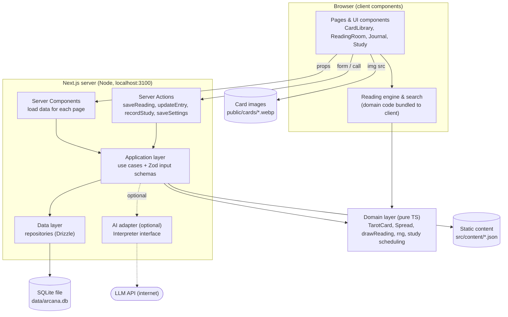

# Arcana — Technical Design

October 12, 2026

## 1. Executive summary

Build Arcana as **one Next.js 16 (App Router) app running on localhost, with SQLite as a single local file accessed through Drizzle ORM**. Static Tarot content lives in version-controlled JSON validated by Zod; user records (readings, journal, study progress, settings) live in SQLite. No separate backend, no auth, no state library.

- **Why Next.js over Vite:** the app needs durable, backup-able storage that survives browser-data clearing. That needs a Node process with file access. Next.js gives that process (Server Components + Server Actions) inside the same project, so there is no separate API service to build. A Vite SPA would need either browser storage (IndexedDB, fragile and hard to back up) or a second server.
- **Domain logic is plain TypeScript** in `src/domain` (cards, spreads, the reading engine, study scheduling). It imports nothing from React, Next.js or the database, and runs in the browser for instant draws and in Vitest for tests.
- **The design system is already built** (Arcana design system artifact: tokens, 23 reference components including the animated reading ritual, 7 screens). Styling ports it as global CSS variables plus CSS Modules, so no Tailwind/shadcn translation layer is needed.
- **It runs offline once installed and built** (fonts self-hosted by `next/font`, card images in `public/`), but it is a localhost website that needs `pnpm start` running — not an installable desktop app. AI features are optional and the only part that needs the internet.

Assumptions: single user on one machine (Windows is likely, so native-module setup is called out); English and Vietnamese UI; one visual theme (Paper) for now.

## 2. Final tech stack

Pin exact versions in `package.json` at Phase 0 (current lines as of today: Next.js 16, React 19, Drizzle ORM 0.45, better-sqlite3 13, Zod 4, Vitest 5, Playwright 1.6x).

| Technology | Purpose | Why it fits Arcana | MVP? | Alternatives considered |
| --- | --- | --- | --- | --- |
| Node.js 24 LTS | Runtime for dev server, build and the local app | LTS line with prebuilt better-sqlite3 binaries; one runtime for everything | Yes | Bun (native-module and Next.js edge cases), Deno |
| Next.js 16, App Router | Pages, routing, server-side data access, mutations via Server Actions | Gives a Node process for SQLite inside the same project, file-based routes for 7 screens, `next/font` self-hosting, `next/image` | Yes | React + Vite SPA (needs IndexedDB or a second server for durable storage), Remix/React Router 7 framework mode (similar, less familiar) |
| React 19 | UI | Comes with Next.js; `useActionState`/`useOptimistic` cover form state | Yes | — |
| TypeScript, `strict: true` | Types across UI, domain and DB | Shared types from JSON schema to DB rows to props | Yes | — |
| CSS Modules + global `tokens.css` | Styling | The design system is already plain CSS on CSS variables; porting is copy-and-split, no utility-class translation | Yes | Tailwind v4 (fast layout, but a second vocabulary over existing tokens), vanilla-extract |
| Own `Icon` set (16 icons) | Icons | Already drawn to match the style; zero dependency | Yes | Lucide (add only if needs outgrow the set) |
| Radix primitives (selective) | Accessible popover/dialog/tooltip behaviour | Only if a pattern needs focus-trapping; the design avoids modals | No (add on demand) | shadcn/ui (brings its own look and Tailwind) |
| Static JSON in `src/content` + Zod | 78 cards, spreads, prompts | Easy to edit and review in Git diffs; validated at load and in tests | Yes | TypeScript data files (less friendly to non-code edits), seeding into SQLite (content becomes hard to diff) |
| SQLite (one file, WAL mode) | Readings, journal, study progress, settings | Survives restarts and browser clearing; a single file to back up; zero setup | Yes | IndexedDB/Dexie (browser-bound), PostgreSQL (needless server), JSON files (no transactions/queries) |
| better-sqlite3 | SQLite driver | Fast, synchronous, mature; works in Next.js server code | Yes | `node:sqlite` built-in (revisit when stable — removes the native build), libSQL client |
| Drizzle ORM + drizzle-kit | Typed queries, schema, SQL migrations | Thin, SQL-shaped, no engine binary; migrations are plain SQL files in Git | Yes | Prisma (heavier toolchain and generate step, more than 4 tables need), raw SQL (no types) |
| Zod 4 | Runtime validation | Card content, Server Action inputs, settings JSON, backup import, env vars | Yes | Valibot (smaller, less familiar) |
| Vitest 5 | Unit + integration tests | Fast, TS-native; domain and repositories (against a temp SQLite file) | Yes | Jest |
| Playwright | End-to-end flows | Draw → save → reopen → edit → delete across a server restart | Yes (a few flows) | Cypress |
| ESLint (flat config, `eslint-config-next`) + Prettier | Lint + formatting | ESLint catches bugs and enforces layer boundaries via `no-restricted-imports`; Prettier formats | Yes | Biome (one tool, but weaker Next.js rule coverage) |
| pnpm | Package manager | Fast, strict dependency tree; needs `onlyBuiltDependencies` for better-sqlite3 | Yes | npm (fine too) |
| `.env.local` + Zod-parsed `env.ts` | Config (DB path, optional AI key) | Next.js loads it natively; no extra tool | Yes | dotenv packages (redundant) |
| Anthropic SDK (or any LLM SDK) behind an interface | Optional AI interpretation, prompts, summaries | Server-only, behind a feature flag; core app never imports it | No (Phase 5) | — |

**Recommended stack:** Node.js 24 LTS · pnpm · Next.js 16 App Router · React 19 · TypeScript strict · CSS Modules on the Arcana design tokens · static JSON content + Zod · SQLite via better-sqlite3 + Drizzle ORM · Vitest · Playwright · ESLint + Prettier. No state library, no Tailwind, no Prisma, no i18n framework in the MVP.

## 3. Architecture

Four layers, dependencies pointing inward only: presentation → application → domain, with the data layer plugged in behind small repository functions. The domain never imports anything outward.



| Layer | Lives in | Responsible for | Must not |
| --- | --- | --- | --- |
| Presentation | `src/app/**`, `src/components/**`, `src/features/*/components` | Routes, layout, design-system components, forms, local UI state (React state, URL search params) | Contain Tarot rules or SQL |
| Application | `src/application/**` | Use cases: `searchCards`, `drawReading`, `saveReading`, `updateJournalEntry`, `deleteJournalEntry`, `recordStudyResult`, `getSettings`; input validation; transactions | Import React or render anything |
| Domain | `src/domain/**` | Types and rules: cards, orientation, spreads and positions, the draw algorithm, RNG, interpretation lookup, quiz generation, Leitner scheduling | Import React, Next.js, Drizzle, `fs` or `Date.now()` directly (time and randomness are injected) |
| Data | `src/content/**`, `src/server/db/**`, `src/server/repositories/**` | Loading and validating static JSON; reading/writing SQLite; backup/restore | Hold business rules beyond mapping rows ↔ types |

Interfaces: the application layer calls repository **modules** with plain typed functions (`journalRepo.create(entry)`), not abstract interfaces with DI containers. The one real seam is the RNG (injected for tests) and, later, the `Interpreter` for AI. Server-only modules start with `import 'server-only'` so they can never be bundled into the browser.

## 4. Architectural decisions and trade-offs

### 4.1 Next.js App Router vs React + Vite

Next.js wins because of storage, not SEO. The deciding requirement is "saved readings persist across restarts" plus easy backup.

|  | Next.js App Router | React + Vite SPA |
| --- | --- | --- |
| Durable storage | SQLite file via server code in the same app | IndexedDB in the browser (lost if site data is cleared, per-browser, awkward to back up) or a second Node server |
| Moving parts | One process, one `package.json` | One SPA + (optionally) one API server = two runtimes to keep in sync |
| Complexity cost | Server/Client Component boundary, caching rules, heavier dev server | Simpler mental model, faster HMR |
| Offline after build | Yes, while `next start` runs | Yes (could even be a PWA) |
| Future desktop packaging | Possible (Electron/Tauri sidecar), not trivial | Easier with Tauri |

Vite would be the right call if storage were browser-only. If that changes (e.g. you want a PWA on the phone), the domain and application layers move over untouched; only routing and data access change.

**How the boundary is used** (this drives several later choices):

- Server Components read data (cards, journal list, settings) and pass plain objects as props.
- Client Components handle interaction: filters, the Reading Room, flashcards, forms. Drawing runs **in the browser** using domain code — instant, no round-trip.
- Mutations go through Server Actions, which call use cases. No REST API in the MVP; one Route Handler exists only for backup download.
- **Pitfall to avoid:** pages that read SQLite must render dynamically. Call `await connection()` (from `next/server`) at the top of those pages, otherwise Next.js may prerender them at build time with stale data. After each mutation call `revalidatePath()` for the affected route.
- All DB code runs on the Node.js runtime (never Edge). better-sqlite3 is a native module that Next.js keeps external to the bundle; if a build ever tries to bundle it, add it to `serverExternalPackages`.

### 4.2 Styling

CSS Modules + the design system's `tokens.css`. The Arcana design system is plain CSS on custom properties (`var(--paper)`, `var(--terracotta-ink)`), so each reference component splits into `Button.tsx` + `Button.module.css` almost verbatim. Tailwind would mean re-expressing every token as a utility and maintaining two vocabularies. shadcn/ui brings its own visual language and Tailwind, so it is skipped; Radix primitives are added one at a time only if a pattern needs them. Visual system stays in `src/components/ui` and never imports domain types beyond simple props.

### 4.3 Where each kind of data lives

| Data | Storage | Why |
| --- | --- | --- |
| Card content (78 cards, EN/VI names, keywords, meanings, symbolism, reflection questions) | JSON files in `src/content/cards/`, Zod-validated | Read-only reference content; edited by hand; Git diff is the review tool. No table needed. |
| Spread definitions | TypeScript in `src/content/spreads.ts` | Few, structured, typed; adding a spread = adding an object |
| UI strings (EN/VI) | `src/i18n/en.ts`, `vi.ts` typed dictionaries | \~200 strings; locale is a setting, not a URL segment, so no i18n framework |
| Readings + drawn cards | SQLite | User-generated, must persist, queried by date |
| Journal entries | SQLite | Same; editable; may exist without a reading |
| Study progress | SQLite (one row per studied card) | Must persist; small; aggregated for progress bars |
| Settings | SQLite, single row of Zod-validated JSON | Server Components need them for first render (language, reversals) — localStorage would cause a flash of wrong language |
| Pure UI conveniences (last library filter, collapsed panels) | URL search params or localStorage | Losing them costs nothing |

**Is a database justified in the MVP?** Yes, from Phase 3 (journal). Phases 1–2 need no database at all. SQLite is the smallest thing that gives durable writes, transactions and simple queries; it is a file, not a server.

### 4.4 ORM: Drizzle vs Prisma

Drizzle: schema in TypeScript, queries that read like SQL, migrations generated as plain `.sql` files, synchronous better-sqlite3 driver, no code-generation step or engine binary. Prisma is excellent but brings a heavier toolchain (generate step, its own schema language) for five tables. Raw SQL would lose type inference between schema and code.

### 4.5 Compatibility constraints

- **better-sqlite3 is a native addon.** pnpm 10+ blocks install scripts by default → add `"pnpm": { "onlyBuiltDependencies": ["better-sqlite3"] }`. On Windows, prebuilt binaries cover Node LTS on x64; if a prebuild is missing, install "Desktop development with C++" (Visual Studio Build Tools). Keep Node on the LTS line.
- SQLite access only from server code (`src/server/**`, Server Actions, Route Handlers). Importing it from a Client Component fails the build — enforced by `import 'server-only'`.
- Fonts: `next/font/google` downloads Fraunces and DM Sans at **build/dev time** and self-hosts them, so the running app needs no Google request.

### 4.6 Things deliberately left out

No state-management library (React state + URL params + server data suffice). No react-hook-form (native forms + Server Actions + Zod). No auth, no API layer, no CI requirement. Each can be added if a concrete need appears. Docker is not left out: it is the runtime for development, tests and the production run (§9), so the host needs no Node.

## 5. Data models and database schema

Two kinds of data, kept apart: **reference content** (cards, spreads — static, in Git) and **user records** (readings, journal, study, settings — in SQLite). User records point at content by stable string IDs (`cardId: 'the-hermit'`, `spreadId: 'three-card'`); content is never copied into the database.

### 5.1 Reference content types (`src/domain/tarot/types.ts`)

```ts
export type Locale = 'en' | 'vi';
export type Localized<T = string> = Record<Locale, T>;

export type Orientation = 'upright' | 'reversed';
export type Suit = 'cups' | 'wands' | 'swords' | 'pentacles';
export type CourtRank = 'page' | 'knight' | 'queen' | 'king';
export type CardId = string; // 'the-hermit', 'cups-03', 'wands-ace', 'swords-queen'

export interface Interpretation {
  summary: Localized;            // 2–4 sentences
  keywords: Localized<string[]>; // 3–5 words
}

interface CardBase {
  id: CardId;
  name: Localized;               // { en: 'The Hermit', vi: 'Ẩn Sĩ' }
  image: string;                 // '/cards/09-the-hermit.webp'
  intro: Localized;              // 1–3 sentence introduction: Card Detail header and the Home card of the day
  keywords: Localized<string[]>; // general keywords for tiles and search
  meanings: Record<Orientation, Interpretation>;
  symbolism: Localized;
  reflectionQuestions: Localized<string[]>;
}

export interface MajorCard extends CardBase { arcana: 'major'; number: number } // 0–21
export interface MinorCard extends CardBase {
  arcana: 'minor';
  suit: Suit;
  rank: number | CourtRank;      // 1 (ace) … 10, or a court rank
}
export type TarotCard = MajorCard | MinorCard;

export interface SpreadPosition {
  key: string;                   // 'past' — stable, stored with each drawn card
  name: Localized;               // { en: 'Past', vi: 'Quá khứ' }
  prompt: Localized;             // 'What shaped this'
  layout: { col: number; row: number; rotate?: 0 | 90 }; // grid hint for the renderer
}

export interface TarotSpread {
  id: string;                    // 'one-card' | 'three-card' | 'celtic-cross'
  version: number;               // bump if positions change meaning
  name: Localized;
  description: Localized;
  grid: { cols: number; rows: number };
  positions: readonly SpreadPosition[]; // array order = draw order
}
```

**Upright vs reversed without duplication:** one record per card, with `meanings.upright` and `meanings.reversed` as two small `Interpretation` objects. Everything else (name, image, symbolism) is shared. The domain helper `interpretationFor(card, orientation)` returns the right one; a reversed card is the same `CardId` plus `orientation: 'reversed'`. Position context is composed at display time (card interpretation + the position's prompt) rather than authoring 78 × positions texts; AI can enrich this later.

The spread's `layout` hint lets one generic `<Spread>` renderer draw any spread from data, so a new spread needs no UI change.

### 5.2 User record types (`src/domain/records.ts`)

```ts
export interface DrawnCard {
  positionIndex: number;   // 0-based, matches spread.positions order
  positionKey: string;     // 'past'
  cardId: CardId;
  orientation: Orientation;
}

export interface Reading {
  id: string;              // uuid
  spreadId: string;
  spreadVersion: number;
  question: string | null;
  cards: DrawnCard[];      // sorted by positionIndex
  drawnAt: Date;
}

export interface JournalEntry {
  id: string;
  readingId: string | null; // null = free reflection without a draw
  cardId: CardId | null;     // the card a free reflection is about (Card Detail, card of the day)
  title: string;
  body: string;
  prompt: string | null;     // the reflection question shown when writing
  tags: string[];            // moods/topics: ['Work', 'Calm']
  createdAt: Date;
  updatedAt: Date;
}

export interface JournalEntryWithReading extends JournalEntry { reading: Reading | null }

export interface StudyProgress {
  cardId: CardId;
  box: 1 | 2 | 3 | 4 | 5;    // Leitner box
  correctCount: number;
  incorrectCount: number;
  lastReviewedAt: Date | null;
  nextReviewAt: Date | null;
}

export interface UserSettings {
  locale: Locale;                       // default 'en'
  theme: 'paper';                       // only theme for now; kept for future
  includeReversed: boolean;             // default true
  revealOneByOne: boolean;              // default true
  defaultSpreadId: string;              // default 'three-card'
  displayName: string | null;           // optional; the Home greeting omits the name when null
  reduceMotion: 'system' | 'on' | 'off'; // default 'system'; drives <html data-motion>
  interpretationDetail: 'brief' | 'full'; // default 'brief'; 'full' adds symbolism + a question per card
}
```

Each type has a matching Zod schema (`UserSettingsSchema`, `SaveReadingInput`, …) in the application layer; `z.infer` types are checked against these interfaces so they cannot drift.

### 5.3 SQLite schema

Five tables. Cards and spreads are **not** tables.

```sql
CREATE TABLE readings (
  id             TEXT PRIMARY KEY,                 -- uuid
  spread_id      TEXT    NOT NULL,
  spread_version INTEGER NOT NULL,
  question       TEXT,
  drawn_at       INTEGER NOT NULL,                 -- unix ms
  created_at     INTEGER NOT NULL
);

CREATE TABLE reading_cards (
  reading_id     TEXT    NOT NULL REFERENCES readings(id) ON DELETE CASCADE,
  position_index INTEGER NOT NULL,
  position_key   TEXT    NOT NULL,
  card_id        TEXT    NOT NULL,                 -- validated against content, not an FK
  orientation    TEXT    NOT NULL CHECK (orientation IN ('upright','reversed')),
  PRIMARY KEY (reading_id, position_index),
  UNIQUE (reading_id, card_id)                     -- no duplicate card in one reading
);

CREATE TABLE journal_entries (
  id          TEXT PRIMARY KEY,
  reading_id  TEXT UNIQUE REFERENCES readings(id) ON DELETE CASCADE, -- 0..1 per reading
  card_id     TEXT,                                -- card a free reflection is about; validated against content
  title       TEXT    NOT NULL,
  body        TEXT    NOT NULL DEFAULT '',
  prompt      TEXT,
  tags        TEXT    NOT NULL DEFAULT '[]',       -- JSON array of strings
  created_at  INTEGER NOT NULL,
  updated_at  INTEGER NOT NULL
);
CREATE INDEX journal_entries_created_at ON journal_entries(created_at DESC);

CREATE TABLE study_progress (
  card_id          TEXT PRIMARY KEY,
  box              INTEGER NOT NULL DEFAULT 1 CHECK (box BETWEEN 1 AND 5),
  correct_count    INTEGER NOT NULL DEFAULT 0,
  incorrect_count  INTEGER NOT NULL DEFAULT 0,
  last_reviewed_at INTEGER,
  next_review_at   INTEGER
);

CREATE TABLE settings (
  id         INTEGER PRIMARY KEY CHECK (id = 1),    -- single row
  data       TEXT    NOT NULL,                      -- JSON, parsed with UserSettingsSchema
  updated_at INTEGER NOT NULL
);
```

**Relationships:** `readings 1—n reading_cards`, `readings 1—0..1 journal_entries`. A reading is only persisted when the user saves it, and saving creates the reading, its cards and its journal entry in **one transaction**. Free reflections are journal entries with `reading_id = NULL`.

**Why tags are a JSON column:** they have no life of their own (no rename, no colour, no counts beyond a filter), so a `tags` + join table would be persistence for its own sake. Promote to a table if tag management appears.

**Deletion:**

- Delete a journal entry that has a reading → delete the reading; `ON DELETE CASCADE` removes its `reading_cards` and the entry. Without a reading → delete the entry only. Both inside `deleteJournalEntry` in one transaction.
- Hard deletes (no soft-delete column) with an inline "Undo" for a few seconds in the UI, which simply re-inserts the snapshot it kept. Backups cover the rest.
- Foreign keys are off by default in SQLite: the connection runs `PRAGMA foreign_keys = ON` and `PRAGMA journal_mode = WAL` on open.

**Integrity across the content boundary:** `card_id` and `spread_id` cannot be foreign keys because content is not in the DB. The save use case validates them against the content registry, and a startup/test check reports any stored ID missing from content. Rule: **never rename a card or spread ID**; if unavoidable, ship a data migration that rewrites stored IDs.

### 5.4 Migration strategy

- Schema is defined in `src/server/db/schema.ts` (Drizzle). `pnpm db:generate` (drizzle-kit) writes numbered SQL files to `drizzle/`; they are committed and reviewed like code.
- `pnpm db:migrate` applies pending files with Drizzle's migrator. It runs automatically before `dev` and `start` (`predev`/`prestart` scripts) and first copies the existing DB file to `data/backups/pre-migrate-<timestamp>.db`.
- Never use `drizzle-kit push` against the real journal; only migrations. Destructive changes are split: add the new column → copy data → drop the old one in a later migration.
- Content changes (JSON) need no migration unless an ID changes (rule above).

## 6. Reading engine design

The engine is three pure functions in `src/domain/reading/`: a partial Fisher–Yates sample (no replacement, unbiased), an orientation coin with an injectable RNG, and a mapper that zips drawn cards onto `spread.positions` in order. It knows nothing about specific spreads, React or storage.

```ts
// src/domain/random.ts
export type Rng = () => number; // uniform float in [0, 1)

export const randomInt = (rng: Rng, maxExclusive: number) =>
  Math.floor(rng() * maxExclusive);

/** Production: Web Crypto, available in browsers and Node. */
export function cryptoRng(): Rng {
  const buf = new Uint32Array(1);
  return () => {
    crypto.getRandomValues(buf);
    return buf[0] / 0x1_0000_0000;
  };
}

/** Tests: deterministic mulberry32. Same seed → same sequence. */
export function seededRng(seed: number): Rng {
  let a = seed >>> 0;
  return () => {
    a = (a + 0x6d2b79f5) >>> 0;
    let t = a;
    t = Math.imul(t ^ (t >>> 15), t | 1);
    t ^= t + Math.imul(t ^ (t >>> 7), t | 61);
    return ((t ^ (t >>> 14)) >>> 0) / 0x1_0000_0000;
  };
}
```

```ts
// src/domain/reading/draw.ts
import type { CardId, DrawnCard, Orientation, TarotSpread } from '../tarot/types';
import { randomInt, type Rng } from '../random';

/** Uniform random k-subset in random order (partial Fisher–Yates). */
export function sampleWithoutReplacement<T>(items: readonly T[], k: number, rng: Rng): T[] {
  if (!Number.isInteger(k) || k < 0 || k > items.length) {
    throw new RangeError(`Cannot draw ${k} from ${items.length}`);
  }
  const pool = items.slice();
  for (let i = 0; i < k; i++) {
    const j = i + randomInt(rng, pool.length - i); // j in [i, n)
    [pool[i], pool[j]] = [pool[j], pool[i]];
  }
  return pool.slice(0, k);
}

export interface DrawOptions {
  rng: Rng;
  includeReversed: boolean;
  reversedChance?: number; // default 0.5
}

export function drawSpread(
  spread: TarotSpread,
  deck: readonly CardId[],
  { rng, includeReversed, reversedChance = 0.5 }: DrawOptions,
): DrawnCard[] {
  const chance = includeReversed ? reversedChance : 0;
  const cards = sampleWithoutReplacement(deck, spread.positions.length, rng);
  return spread.positions.map((position, i) => ({
    positionIndex: i,
    positionKey: position.key,
    cardId: cards[i],
    orientation: (rng() < chance ? 'reversed' : 'upright') satisfies Orientation,
  }));
}
```

```ts
// src/application/readings/drawReading.ts — the use case the Reading Room calls (client-side)
export function drawReading(
  spreadId: string,
  settings: Pick<UserSettings, 'includeReversed'>,
  deps = { rng: cryptoRng(), now: () => new Date(), newId: () => crypto.randomUUID() },
): Reading {
  const spread = getSpread(spreadId);           // throws on unknown id
  return {
    id: deps.newId(),
    spreadId: spread.id,
    spreadVersion: spread.version,
    question: null,
    cards: drawSpread(spread, ALL_CARD_IDS, { rng: deps.rng, includeReversed: settings.includeReversed }),
    drawnAt: deps.now(),
  };
}
```

**Why it is unbiased:** each step picks `j` uniformly from the remaining `n − i` items, so every ordered k-subset has probability 1 / (n · (n−1) · … · (n−k+1)). The common bug — `j = randomInt(rng, n)` over the whole array, or `sort(() => Math.random() - 0.5)` — is biased and is not used. Turning a 32-bit value into an index with `floor(x · n)` has a bias below n / 2³² (under 2 × 10⁻⁸ for 78 cards), far below anything observable; switch `randomInt` to rejection sampling if exactness ever matters.

**Display:** `interpret(drawn, card, spread)` returns `{ position, card, orientation, meaning: card.meanings[drawn.orientation] }` so the UI shows the position name and prompt, then the orientation-specific meaning.

**Adding a spread** = adding one `TarotSpread` object to `src/content/spreads.ts` (positions with keys, names, prompts and grid layout). The engine uses only `positions.length` and order; the generic renderer uses `layout`. No engine change, no UI change. A spread that ever needs special rules (e.g. a significator chosen by the user) would pass a filtered `deck` in — still no engine change.

**Tests** (`draw.test.ts`):

- `rng = () => 0` gives `j = i` every step → the first k cards in deck order, all reversed (0 < 0.5) — exact expected output.
- Seeded snapshot: `seededRng(42)` for Celtic Cross matches a stored result (guards accidental algorithm changes).
- For 10,000 seeds: length = positions, no duplicate `cardId`, `positionIndex` = 0…n−1, `positionKey` matches the spread.
- `includeReversed: false` → every card upright across 1,000 draws.
- Uniformity: 78,000 one-card draws with a seeded RNG; chi-square statistic over 78 bins below 122 (p ≈ 0.001, 77 degrees of freedom). Orientation share within 0.5 ± 0.02.
- Requesting more cards than the deck throws `RangeError`.

## 7. Data flow

Reads of static content and all drawing happen without touching the database; only saving and loading user records go through a Server Action or Server Component to SQLite.

| Scenario | Client (browser) | Server (Next.js, Node) | SQLite |
| --- | --- | --- | --- |
| 1. Search for a card | Typing updates `?q=&arcana=&sort=` in the URL; `searchCards(cards, query)` filters the 78 summaries in memory (accent-insensitive, so "an si" finds "Ẩn Sĩ") | `library/page.tsx` (Server Component) loads card summaries from the content registry once and passes them as props; `library/[cardId]/page.tsx` renders the detail page (statically generated for all 78 ids) | — |
| 2. Draw three cards | Reading Room calls `drawReading('three-card', settings)` → domain engine with `cryptoRng()`; result held in React state; cards turn over one by one | Only the initial page load (settings + spread definitions as props) | — (nothing saved yet) |
| 3. Save a reading to the journal | Form posts `{ reading, title, body, prompt, tags }` to the `saveReading` Server Action; button shows pending state; on success the success Notice appears | Action parses input with Zod → `saveReadingUseCase` checks card and spread ids against content, no duplicates, position count → repository writes in one transaction → `revalidatePath('/journal')` → returns `{ entryId }` | `INSERT readings`, `INSERT reading_cards × 3`, `INSERT journal_entries` (one transaction) |
| 4. Reopen a saved reading | Renders the spread and meanings; edit form for title/body/tags posts to `updateJournalEntry`; delete posts to `deleteJournalEntry` | `journal/[entryId]/page.tsx` (dynamic) → `getJournalEntry(id)` → joins the reading and its cards → enriches each `cardId` with content (name, image, meaning for its orientation, position name) → props | `SELECT` entry + reading + cards by id |
| 5. Complete a study session | Flashcard/quiz session runs fully in the browser (questions generated by domain `buildQuiz(cards, rng)`); answers collected in state; at the end posts `[{cardId, correct}]` to `recordStudySession` | Action validates → domain `nextLeitnerState(progress, correct, now)` per card → repository upserts → `revalidatePath('/study')`, `revalidatePath('/')` | `INSERT … ON CONFLICT(card_id) DO UPDATE` per card, one transaction |

Notes:

- Content is bundled where it is used: Server Components import the JSON registry; the Reading Room receives only the card ids and the minimal fields it needs for the reveal, keeping the client bundle small.
- Settings load in the root layout (Server Component) on every request and flow down as props, so language and reversal preference are correct on first paint.
- Optional AI (Phase 5) would be a separate Server Action, `interpretReading(readingId)`, called on demand after a draw; its output is shown and may be saved into the journal body. Nothing in scenarios 1–5 depends on it.

## 8. Project folder structure

One repository, one app. Unit tests sit next to the code they test; end-to-end tests live in `e2e/`.

```
arcana/
├─ Dockerfile, compose.yaml, .dockerignore   # dev / e2e / production images (see §9)
├─ src/
│  ├─ app/                          # Next.js routes (presentation)
│  │  ├─ layout.tsx                 # fonts, tokens.css, settings, AppNav
│  │  ├─ page.tsx                   # Home
│  │  ├─ library/page.tsx
│  │  ├─ library/[cardId]/page.tsx
│  │  ├─ reading/page.tsx
│  │  ├─ study/page.tsx
│  │  ├─ journal/page.tsx
│  │  ├─ journal/[entryId]/page.tsx
│  │  ├─ journal/new/page.tsx       # free reflection
│  │  ├─ settings/page.tsx
│  │  └─ api/backup/route.ts        # GET = download JSON export
│  ├─ components/ui/                # design-system port, no domain logic
│  │  ├─ Button/Button.tsx + Button.module.css
│  │  ├─ TarotCard/ …  Spread/ …  Notice/ …  (23 components)
│  │  └─ Icon/
│  ├─ features/                     # screen-level UI + Server Actions per module
│  │  ├─ library/   (CardBrowser.tsx, CardDetail.tsx)
│  │  ├─ reading/   (ReadingRoom.tsx, SaveReadingForm.tsx, actions.ts)
│  │  ├─ journal/   (EntryList.tsx, EntryEditor.tsx, actions.ts)
│  │  ├─ study/     (FlashcardSession.tsx, Quiz.tsx, actions.ts)
│  │  └─ settings/  (SettingsForm.tsx, actions.ts)
│  ├─ application/                  # use cases + Zod input schemas
│  │  ├─ cards/searchCards.ts (+ .test.ts)
│  │  ├─ readings/drawReading.ts, saveReading.ts
│  │  ├─ journal/journal.ts         # get/list/update/delete
│  │  ├─ study/recordStudySession.ts
│  │  └─ settings/settings.ts
│  ├─ domain/                       # pure TS: no react/next/drizzle imports
│  │  ├─ tarot/types.ts, interpret.ts
│  │  ├─ reading/draw.ts (+ draw.test.ts)
│  │  ├─ study/leitner.ts, quiz.ts
│  │  ├─ records.ts
│  │  └─ random.ts
│  ├─ content/                      # static reference data
│  │  ├─ cards/major.json, cups.json, wands.json, swords.json, pentacles.json
│  │  ├─ spreads.ts
│  │  ├─ schema.ts                  # Zod schemas for content
│  │  └─ index.ts                   # parse once, export ALL_CARDS, getCard, getSpread
│  ├─ server/                       # server-only (import 'server-only')
│  │  ├─ env.ts                     # Zod-parsed process.env
│  │  ├─ db/client.ts               # better-sqlite3 + pragmas + drizzle()
│  │  ├─ db/schema.ts               # Drizzle tables
│  │  ├─ repositories/readings.ts, journal.ts, study.ts, settings.ts
│  │  └─ backup.ts                  # file backup, JSON export/import
│  ├─ i18n/en.ts, vi.ts, index.ts   # typed UI strings, t(locale, key)
│  └─ styles/tokens.css, globals.css
├─ drizzle/                         # generated SQL migrations (committed)
├─ scripts/migrate.ts, backup.ts, restore.ts
├─ public/cards/*.webp               # 78 images from the design system Tarot group
├─ data/                            # gitignored: arcana.db, backups/
├─ e2e/journal.spec.ts, reading.spec.ts
├─ .env.example                     # committed; .env.local is gitignored
├─ drizzle.config.ts, next.config.ts, vitest.config.ts, playwright.config.ts
└─ eslint.config.mjs, .prettierrc, tsconfig.json, package.json
```

**Boundary rule, enforced by ESLint `no-restricted-imports`:** `src/domain/**` may not import `react`, `next/*`, `drizzle-orm`, `better-sqlite3`, `@/server/*` or `@/components/*`; `src/application/**` may not import `react` or `next/*` UI modules; `src/components/ui/**` may not import `@/server/*` or `@/application/*`. Path alias `@/` → `src/`.

## 9. Local development setup

Everything runs in Docker containers (Node 24 inside), so the host needs only Docker with Compose and pnpm. After that `pnpm docker:dev` is the only daily command. The database file and backups live in `data/` inside the project (bind-mounted into the containers) and are never committed.

**Prerequisites:** Docker with Compose, pnpm (`corepack enable`), Git. No Node on the host is required. No native toolchain is required either: the Node 24 image has prebuilt better-sqlite3 binaries.

**First run:**

1. `git clone … && cd arcana`
2. `cp .env.example .env.local` (defaults work as-is; put `ARCANA_PORT` in `.env` to change the port)
3. `pnpm docker:dev` → installs dependencies into the bind-mounted `node_modules`, runs `predev` (`db:migrate`, which creates `data/arcana.db` if missing, from Phase 3) → http://localhost:3100

**Containers** (`compose.yaml`, `Dockerfile` with `dev`, `e2e`, `build` and `runner` stages):

- `app`: the dev server. The project folder is bind-mounted and the container runs as the host user, so `node_modules` and `.pnpm-store` stay on the host and the editor sees them. Host port `ARCANA_PORT` (default **3100**, because 3000 is often taken) maps to container port 3000.
- `e2e` (profile `e2e`): same mounts plus Chromium (version-matched to Playwright). Builds into `.next-e2e` so it never disturbs the dev server, serves the production build and runs Playwright.
- `app-prod` (profile `prod`): the standalone production image (`output: 'standalone'`), `restart: unless-stopped`; from Phase 3 it also mounts `data/`.
- On Windows or macOS bind mounts are slower and SQLite WAL on them can misbehave: use a named volume for `data/` there. On Linux a bind mount is fine.

**Scripts** (run inside the container; the host wrappers are `pnpm docker:dev` / `docker:check` / `docker:e2e` / `docker:prod` / `docker:sh`):

| Script | Does |
| --- | --- |
| `pnpm dev` | Migrate, then Next.js dev server with hot reload |
| `pnpm build` / `pnpm start` | Production build, then migrate + serve on container port 3000, published as localhost:3100 (faster, what you use day to day) |
| `pnpm db:generate` | Create a new SQL migration from `schema.ts` changes |
| `pnpm db:migrate` | Back up the DB file, then apply pending migrations |
| `pnpm db:backup` / `pnpm db:restore <file>` | File-level backup / restore (app must be stopped for restore) |
| `pnpm test` / `pnpm test:e2e` | Vitest / Playwright |
| `pnpm lint` / `pnpm typecheck` / `pnpm format` | ESLint / `tsc --noEmit` / Prettier |

**Where things live:**

- Database: `data/arcana.db` (plus `-wal`/`-shm` files while running). Path configurable with `ARCANA_DB_PATH`.
- Backups: `data/backups/`.
- Card images: `public/cards/<slug>.webp` (copied from the design system's Tarot asset group; served by Next.js, rendered with `next/image`).
- Card text: `src/content/cards/*.json`.

**Environment variables** (`.env.local`, parsed by `src/server/env.ts` with Zod; startup fails with a clear message if invalid):

```bash
ARCANA_DB_PATH=./data/arcana.db   # optional, this is the default
# Phase 5, optional:
# ARCANA_AI_ENABLED=false
# ANTHROPIC_API_KEY=
```

No variable is required for the core app. Secrets never get a `NEXT_PUBLIC_` prefix (that would ship them to the browser).

**Backup and restore:**

- *File backup* (complete, exact): `pnpm db:backup` uses SQLite's online backup API (`db.backup()`), safe while the app runs, writing `data/backups/arcana-YYYY-MM-DD-HHmm.db`. Automatic copy before every migration. Restore = stop the app, `pnpm db:restore <file>` (copies it over `arcana.db` after backing up the current one).
- *Portable export* (human-readable, version-independent): Settings → "Export journal" downloads JSON (`{ version, exportedAt, readings, journalEntries, studyProgress, settings }`) from `/api/backup`. "Import" validates the file with Zod and inserts in one transaction, skipping ids that already exist.
- Recommended habit: keep `data/backups/` inside a folder you already sync (OneDrive, Google Drive), or copy the JSON export there weekly. Syncing the live `arcana.db` itself is not recommended (WAL files can be caught mid-write).

**Localhost website vs offline app:**

- Arcana is a website served by a Node process on your machine. It works only while `pnpm start` (or `pnpm dev`) is running, in a browser tab at localhost:3100.
- After `pnpm install` and `pnpm build` (both need internet: packages and the Google font files `next/font` downloads), the running app makes **no network requests**: fonts are self-hosted, images are local, data is local. So it works with Wi-Fi off.
- It is not an installable desktop or mobile app, has no service worker, and cannot run without Node. Optional AI features need the internet and an API key.
- To make it feel like an app later: a start-on-login script, a browser "Install as app" shortcut, or packaging (Phase 5+, deferred).

## 10. Testing strategy

Most confidence comes from fast Vitest tests on the domain and on repositories against a real temporary SQLite file; Playwright covers five user journeys end to end, including a server restart.

| Level | Tool | What | Runs against |
| --- | --- | --- | --- |
| Unit | Vitest | Domain (engine, interpret, Leitner, quiz), `searchCards`, Zod schemas, i18n key parity | Pure functions, seeded RNG |
| Content | Vitest | The 78-card JSON | Parsed content registry |
| Integration | Vitest | Use cases + repositories + migrations | A fresh temp DB file per test file (`mkdtemp`), migrations applied |
| End to end | Playwright | Real browser flows | `pnpm build && pnpm start` with `ARCANA_DB_PATH` pointing to a temp file |

**Required tests:**

- **Content validity:** all files parse with `TarotCardSchema`; exactly 78 cards; 22 major numbered 0–21 with no gaps; 14 per suit with ranks 1–10 + four courts; all ids unique; every `image` exists in `public/cards/`; every card has EN and VI names, both meanings, at least one reflection question per locale.
- **Spreads:** each spread has unique position keys; layout cells inside its grid; Celtic Cross has 10 positions.
- **Search and filter:** name match in EN and VI, accent-insensitive ("an si" → The Hermit); keyword match; arcana and suit filters combine; sort by number and by name; empty query returns all 78.
- **Draw:** the engine tests in §6 (no duplicates, position mapping, reversals off, uniformity, error cases).
- **Interpretation:** `interpret()` returns `meanings.upright` for upright and `meanings.reversed` for reversed for the same card; position name/prompt come from the right index.
- **Journal (integration):** save creates 1 reading + n cards + 1 entry in one transaction; a failure mid-way (e.g. duplicate card) leaves zero rows; get returns cards in position order; update changes title/body/tags and `updated_at` only; delete with a reading removes reading, cards and entry; delete of a free reflection removes only the entry; unknown card id is rejected.
- **Persistence after restart (integration):** write through repositories, close the better-sqlite3 handle, open a new one on the same file, read back identical data.
- **Study:** correct answer moves box up (max 5), wrong answer resets to box 1, `next_review_at` follows the box schedule; upsert creates rows on first study.
- **Settings:** missing row returns defaults; invalid stored JSON falls back to defaults and is logged, never crashes the layout.
- **Backup:** export → wipe → import produces identical rows; import rejects a malformed file without writing anything.

**End-to-end flows (Playwright):**

1. Library: search "hermit", filter Major arcana, open detail, toggle Reversed.
2. Reading: draw three cards, reveal all, save with a note → success notice → entry appears in Journal.
3. Journal: open the entry, edit the note, save, reload → change kept; delete → gone from the list.
4. Restart: save an entry, stop and restart the server in the test (`webServer` restarted via a helper), entry still listed.
5. Settings: switch language to Tiếng Việt → nav and card names change; turn off reversed cards → a draw has no reversed cards.

Also run an automated accessibility scan (`@axe-core/playwright`) on each page in Phase 5. Gate before merging each phase: `pnpm typecheck && pnpm lint && pnpm test` green, plus `pnpm test:e2e` from Phase 0, all run in the containers.

## 11. Implementation roadmap

Six phases, each merged only when its tests pass. The database first appears in Phase 3; everything before it runs on static content alone.

Phase 0 → 1 → 2 run on static content only; SQLite arrives in Phase 3; then 4 → 5. Gate between phases: typecheck, lint and that phase's tests green, end-to-end included from Phase 0.

### Phase 0 — Project setup and architecture foundation

- **Scope:** create the Next.js app (TypeScript strict, App Router, ESLint), add Prettier, Vitest, Playwright; path alias `@/`; layer folders with boundary lint rules; port `tokens.css` and fonts via `next/font`; root layout with `AppNav`; empty pages for the 6 top-level routes (detail and new-entry routes arrive with their features); `env.ts`; Dockerfile and `compose.yaml`; the `data-motion` switch for reduced motion.
- **Main files:** `package.json`, `tsconfig.json`, `eslint.config.mjs`, `vitest.config.ts`, `playwright.config.ts`, `src/app/layout.tsx`, `src/styles/tokens.css`, `src/components/ui/{Button,Icon,AppNav}`, `src/server/env.ts`.
- **Depends on:** nothing.
- **Done when:** `pnpm dev` shows the cream layout with working navigation between 6 placeholder pages; a domain file importing `react` fails lint.
- **Tests:** one sample Vitest test, one Playwright smoke test (each route returns 200, shows its title and marks its nav item); `typecheck`, `lint` green.

### Phase 1 — Tarot data model and card library

- **Scope:** domain types; Zod content schema; card JSON for all 78 cards (EN + VI); copy the 78 images into `public/cards/`; content registry; `searchCards`; Library page (search, arcana/suit filter, sort, URL state); Card Detail page (Upright/Reversed toggle, meanings, symbolism, reflection questions); `TarotCard`, `CardTile`, `Tag`, `SegmentedControl`, `MeaningPanel`, `TextField` components; i18n dictionaries.
- **Main files:** `src/domain/tarot/*`, `src/content/{schema.ts,index.ts,cards/*.json}`, `src/application/cards/searchCards.ts`, `src/features/library/*`, `src/i18n/*`.
- **Depends on:** Phase 0.
- **Done when:** all 78 cards browse, filter and open; language switch (temporary toggle) shows Vietnamese names; detail pages are statically generated.
- **Tests:** content validity suite, search/filter/sort suite, `interpret()` upright/reversed tests, i18n key parity, e2e flow 1.
- **Note:** writing 78 × 2 languages of meanings is the largest content task. Drafting with an LLM and reviewing by hand works; the schema and tests do not change.

### Phase 2 — Reading engine and spreads

- **Scope:** `random.ts`, `draw.ts`, `interpret.ts`; spread definitions (one-card, three-card, Celtic Cross) with layout hints; `drawReading` use case; Reading Room page with spread picker, face-down cards revealed one by one, the generic `Spread` renderer and legend, meanings per position; "Draw again". No saving yet.
- **Main files:** `src/domain/random.ts`, `src/domain/reading/*`, `src/content/spreads.ts`, `src/application/readings/drawReading.ts`, `src/features/reading/ReadingRoom.tsx`, `src/components/ui/{Spread,Notice}`.
- **Depends on:** Phase 1 (cards, `TarotCard`).
- **Done when:** all three spreads draw, reveal and show position + orientation meanings; reduced-motion setting is respected.
- **Tests:** full engine suite (§6), spread definition tests, component test that the renderer places N cards for an N-position spread.

### Phase 3 — Journal and persistent storage

- **Scope:** better-sqlite3 + Drizzle; schema and first migration; `db:migrate`/`db:backup`/`db:restore` scripts; repositories; `saveReading`, journal get/list/update/delete use cases and Server Actions; Save form in the Reading Room; Journal list (by month, filters), entry page (reopen spread, edit, delete with undo), free reflection page; settings table + Settings page (language, reversals, reveal one by one, default spread, reduce motion); JSON export/import.
- **Main files:** `src/server/db/*`, `src/server/repositories/*`, `src/server/backup.ts`, `drizzle/*.sql`, `src/application/{readings/saveReading.ts,journal/*,settings/*}`, `src/features/{journal,settings}/*`, `src/app/api/backup/route.ts`.
- **Depends on:** Phase 2 (a `Reading` to save).
- **Done when:** a reading can be saved, reopened, edited and deleted; data survives `pnpm start` restarts; settings change rendering on first paint; export/import round-trips.
- **Tests:** journal integration suite, persistence-after-reopen test, settings defaults/fallback, backup round-trip, e2e flows 2–5.

### Phase 4 — Study features and progress tracking

- **Scope:** `leitner.ts` and `quiz.ts` in the domain; `study_progress` repository; flashcard session and multiple-choice quiz (name ↔ image, keyword → card, upright vs reversed); `recordStudySession`; progress per suit on Study and Home; Home dashboard (card of the day, reflection prompt, progress, quick actions).
- **Main files:** `src/domain/study/*`, `src/server/repositories/study.ts`, `src/application/study/*`, `src/features/study/*`, `src/app/page.tsx`.
- **Depends on:** Phase 1 (content), Phase 3 (database).
- **Done when:** a 10-card session updates progress that persists; Home shows real progress; card of the day is stable for a calendar day (seeded by the date).
- **Tests:** Leitner transitions, quiz generation (no duplicate options, correct answer included, deterministic with seed), study upsert integration test, e2e: finish a session → progress bar changes.

### Phase 5 — Polish, accessibility and optional AI

- **Scope:** keyboard and screen-reader pass (focus order, labels, live regions for reveal/save), axe scan, responsive bottom nav, empty and error states, performance check (image `sizes`, bundle size); optional AI: `Interpreter` interface + one server-only adapter behind `ARCANA_AI_ENABLED`, "Ask for an interpretation" and "Suggest a reflection question" buttons that only appear when enabled.
- **Main files:** `src/application/ai/interpreter.ts`, `src/server/ai/anthropic.ts`, `src/features/reading/InterpretButton.tsx`, touch-ups across `components/ui`.
- **Depends on:** Phases 1–4.
- **Done when:** no serious axe violations; app fully usable by keyboard; with AI disabled or offline, nothing breaks and no AI UI shows.
- **Tests:** axe e2e on every page, AI adapter tested with a fake `Interpreter`, e2e run with AI disabled.

## 12. Risks, limitations and future improvements

The biggest practical risks are the native SQLite build on Windows and the size of the bilingual content task; neither changes the architecture.

| Risk / limitation | Impact | Mitigation |
| --- | --- | --- |
| better-sqlite3 native build fails (new Node version, Windows without build tools) | Install fails | Stay on Node LTS; `onlyBuiltDependencies`; Build Tools as fallback; `node:sqlite` as a drop-in replacement once stable (Drizzle supports both) |
| Writing 78 cards × EN/VI meanings | Phase 1 takes longest | LLM-assisted drafts + human review; schema-driven tests catch gaps |
| Server/Client Component confusion (DB import in client code, prerendered DB pages) | Build errors or stale pages | `server-only`, `await connection()` on DB pages, `revalidatePath` after mutations, lint boundaries |
| Card or spread id renamed in content | Old readings point at nothing | IDs are permanent; integrity check on startup and in tests; data migration if ever needed |
| Single file database | Disk loss = data loss | Pre-migration backups, `db:backup`, JSON export into a synced folder |
| Rider–Waite–Smith image rights | Public domain in the US (1909); may differ elsewhere | Fine for personal use; check before any public or commercial release |
| Localhost only | No phone access, needs Node running | Accepted for MVP; options below |
| AI outputs | Cost, privacy (journal text leaves the machine), quality | Off by default, explicit per-use action, nothing sent automatically |

**Future improvements (not in MVP):** spaced-repetition tuning or FSRS for study; custom spreads created in the UI (spread definitions move from TS into a table only then); full-text search over journal entries (SQLite FTS5); a dark "Evening" theme; tag management; packaging as a desktop app (Tauri/Electron) or LAN/phone access; AI journal summaries.

**Open decisions (deferred on purpose):**

- Whether settings and UI language should also be switchable per-session without a reload (currently a Server Action + revalidate, which is enough).
- Exact Leitner intervals (proposal: 1, 2, 4, 8, 16 days) — tune after using it.
- Whether a reading can be saved without a journal note (currently: saving always creates an entry; the note may be empty).
- AI provider and model — decided in Phase 5.
